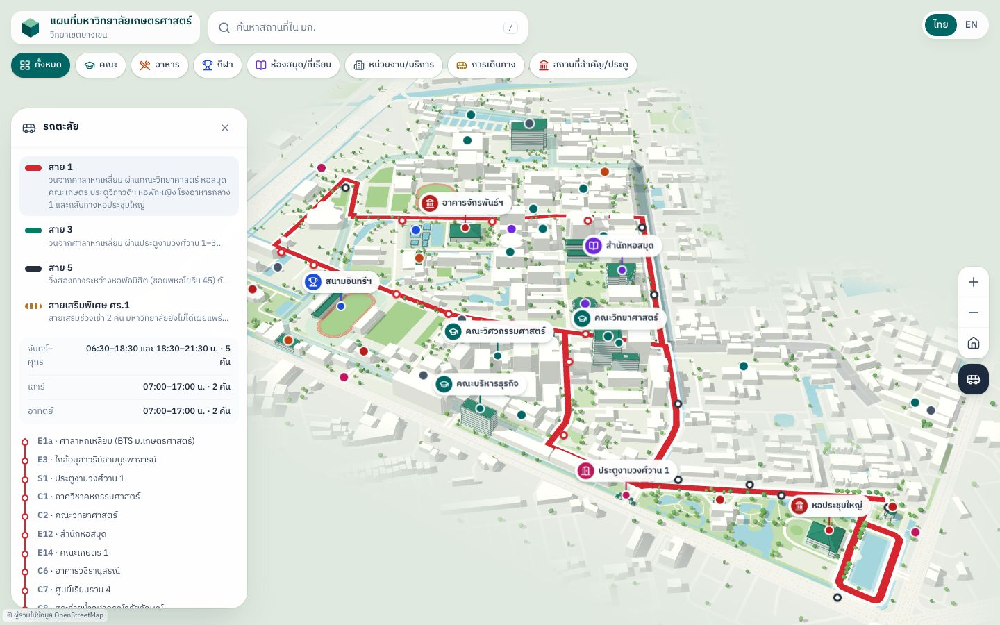

# KU Campus Map · แผนที่มหาวิทยาลัยเกษตรศาสตร์ บางเขน

An interactive 3D map of Kasetsart University's Bangkhen campus, in Thai and
English, for phones and desktops. The buildings, roads, water and trees come
from OpenStreetMap; 16 landmarks have hand-styled models. You can search places
(Thai or English, nicknames included), filter by category, open a place for its
description and photos, and switch on the KU shuttle (รถตะลัย) routes and stops.
It is a static site (no backend).

**Live:** https://ku-map-beta.vercel.app




This is an unofficial project, not affiliated with or endorsed by Kasetsart University.

> Want to know how it works? Read [docs/ARCHITECTURE.md](docs/ARCHITECTURE.md).

---

## Features

- **3D campus** with a near-isometric default view, KU-green landmarks, a soft fade at the campus edge, and render-on-demand (nothing is drawn while the map is still).
- **Google Maps–style touch gestures**, written by hand: pan with fling, pinch zoom, two-finger rotate and tilt, double-tap zoom, double-tap-and-drag one-handed zoom, two-finger tap to zoom out. Mouse and keyboard on desktop.
- **38 places** in 8 categories (faculty, food, sport, library, admin, transport, landmark, gate), each with Thai and English text, sources and, where available, photos.
- **Search** in Thai and English: substring matching on Thai text, nicknames (`searchAliases`), shuttle stop codes ("E12"), keyboard navigation on desktop.
- **Category filter chips** (multi-select) that hide non-matching pins and narrow search results.
- **Place details**: a floating card on desktop, a three-position bottom sheet on mobile that can be dragged from anywhere on it. Places are shareable: `?place=library`.
- **Phone back gesture** closes the sheet or search instead of leaving the site.
- **Shuttle overlay**: lines 1, 3 and 5 as one continuous route each, stops with their serving lines, hours per day, and a note on where the data comes from.
- **Thai by default**, English one tap away; the choice is remembered.
- **Link previews** (LINE, Facebook, X) with a generated share image.
- **`?debug=1`** overlay: frame time, DPR, draw calls, and switches for shadows, blur, pins, stops and trees.

## Tech stack

| Piece | Why |
|---|---|
| [Vite](https://vite.dev) 8 | Fast dev server and a simple static build; `json: { stringify: true }` makes big JSON imports cheap to parse. |
| React 19 + TypeScript | UI shell and typed content data (`src/data/types.ts`). |
| three.js + [@react-three/fiber](https://r3f.docs.pmnd.rs) + drei | 3D scene as React components; `frameloop="demand"` gives render-on-demand; drei supplies `OrbitControls` for the desktop mouse. |
| Tailwind CSS 4 | Utility styling, with the KU colour scale as theme tokens (`src/index.css`). |
| react-i18next | Thai/English UI strings in two JSON files. |
| OpenStreetMap via Overpass | Real building, road and water geometry, fetched once by a script (the app never calls Overpass). |
| topojson | Compact map data: one quantised file instead of six GeoJSON files. |
| Playwright (`playwright-core`) | Browser tests that drive real touch input; also WebKit for Safari. |
| Python (Pillow, numpy, scipy) | One-off tool that traces the shuttle routes from KU's route-map images. |

## Quick start

Requires Node 22 (what development and CI use) and npm.

```bash
npm install
npm run dev                 # http://localhost:5173
npm run dev -- --host       # also reachable on your LAN, for testing on a phone
npm run build               # type-check + production build into dist/
npm run preview             # serve dist/ locally
npm run typecheck
```

**On a phone:** run `npm run dev -- --host`, then open `http://<your computer's LAN IP>:5173` (same Wi-Fi). Add `?debug=1` to see the performance overlay.

**Build environment:** `VITE_SITE_URL` (see [Deployment](#deployment)). `.env` holds a placeholder; local builds warn about it, builds on Vercel/CI fail until it is set.

## Project structure

```
src/
  App.tsx                 wires everything: selection, shuttle state, taps, layout insets
  data/                   content (edit these)
    landmarks.ts            38 places: text, coordinates, photos, aliases, sources
    shuttle.ts              shuttle lines, stops, service hours
    shuttle-paths.json      generated route polylines
    types.ts                Landmark / Category / Localized types
    osm.ts + osm/           map data (generated; osm/campus.topo.json is what the app loads)
  i18n/locales/           th.json, en.json: every UI string
  lib/                    geo.ts (lat/lng → metres), search.ts (index + ranking), perf.ts (debug flags)
  scene/                  the 3D map (loaded lazily as its own chunk)
    CampusMap.tsx           Canvas, sun/shadows, camera rig, scene build stages
    BaseLayers.tsx          ground, roads, water, buildings from OSM
    models.ts, modelSpecs.ts  the 16 hand-styled landmark models
    Trees.tsx, ShuttleLayer.tsx, campusFade.ts, quality.tsx
    Pins.tsx, StopProjector.tsx, pinBridge.ts, stopBridge.ts   DOM pins ↔ 3D camera
    camera/mapCamera.ts     camera controller (fly-to, zoom, fling)
    camera/touchGestures.ts custom touch gesture recogniser
  ui/                     React UI: header, search, filters, cards, bottom sheets, shuttle panels
scripts/
  fetch-osm.ts            download OSM data, then run derive-osm
  derive-osm.ts           trees, campus fade mask, compact TopoJSON
  shuttle/trace_routes.py trace shuttle routes from KU's map images
  shuttle/validate-paths.ts  checks the traced routes (also `npm run test:shuttle-data`)
  og-image.mjs            renders public/og-image.jpg from the live map
tests/e2e/                Playwright suites; tests/perf/profile.mjs frame-cost profiler
docs/                     ARCHITECTURE.md, performance.md, landmark-review.md, screenshots/
public/                   favicon, icons, manifest, og-image.jpg, images/landmarks/*.jpg
```

## Editing content

### Landmarks: `src/data/landmarks.ts`

Each place is one object in the `raw` array:

```ts
{
  id: 'library',                       // stable and URL-safe: used in ?place=library and as the photo file name
  category: 'library',                 // faculty | food | sport | library | admin | transport | landmark | gate
  featured: true,                      // optional: label priority; a detailed model needs an entry in scene/modelSpecs.ts too
  coordinates: { lat: 13.848107, lng: 100.571813 },
  coordSource: 'osm',                  // osm | derived | manual (use 'manual' when you move a pin by hand)
  osmId: 'way/336752159',              // optional
  name:      { th: 'สำนักหอสมุด', en: 'KU Library' },     // shown in the detail panel
  shortName: { th: '…', en: '…' },     // optional: the map label (labels are never truncated, so keep it short)
  description: { th: '…', en: '…' },
  images: [ /* see below */ ],
  searchAliases: ['หอสมุด', 'ห้องสมุด', 'library'],      // nicknames and alternate spellings
  sources: ['https://…'],              // where the facts came from
  notes: '…',                          // editorial notes, never shown in the UI
}
```

- **Search:** matching ignores case, spaces and punctuation, and Thai matches anywhere inside a word. Add nicknames to `searchAliases`.
- **A place waiting for coordinates:** two commented-out entries (พระพิรุณทรงนาค, หออนุสรณ์ 60 ปี) sit at the bottom of the file. Fill in lat/lng, set `coordSource: 'manual'`, and move them into `raw`.
- **A detailed 3D model** (optional): add the landmark to `landmarkModels` in `src/scene/modelSpecs.ts` with its OSM building id(s) and a style, and set `featured: true`.

### Photos

Two helpers in `landmarks.ts`:

```ts
// Your own photo: save it as public/images/landmarks/<id>.jpg, then:
images: [own('Your Name', 'CC BY 4.0')],          // own() fills in the file name from the landmark's id

// A Wikimedia Commons photo (hotlinked through Special:FilePath):
images: [commons('File name on Commons.jpg', 'Author', 'CC BY-SA 4.0')],
```

`own(author, licence, file?)` returns an image with `url: 'images/landmarks/{id}.jpg'`; `withOwnImages()` replaces `{id}` with the landmark's id. A third argument uses another file name. Every photo's author and licence are shown under it in the detail panel. A landmark with `images: []` shows a styled placeholder.

### Shuttle data: `src/data/shuttle.ts`

```ts
{ code: 'E12', id: 'e12', osmId: 'node/891278241', coordinates: { lat: 13.847771, lng: 100.57251 },
  coordSource: 'osm',                    // osm | official-map (read from KU's map; approximate)
  name: { th: 'สำนักหอสมุด', en: 'KU Library' } }
```

A line (`shuttleLines`) has `color`, `name`, `summary`, `service` (buses and hours per day), `notes` and `stops`, the ordered stop ids. **Which lines serve a stop is derived from those lists** (`linesByStop`), so there is nothing to keep in sync. The drawn route is `shuttle-paths.json`, generated (see below); changing a line's stops means re-running the trace.

### Translation strings: `src/i18n/locales/th.json` and `en.json`

Components never contain Thai or English text; they call `t('some.key')`. Add the key to **both** files:

```json
"shuttle": { "close": "Close shuttle" }     // en.json
"shuttle": { "close": "ปิดรถตะลัย" }          // th.json
```

Landmark and shuttle text is not in these files: it lives next to its data as `{ th, en }` pairs.

## Data pipeline

| Script | What it does | Re-run when |
|---|---|---|
| `npm run fetch-osm` | Downloads buildings, roads, water, green areas, sports areas and trees from Overpass for the campus plus a 350 m margin; writes `src/data/osm/*.json`; then runs `derive-osm`. | You want newer OSM edits. Overpass is sometimes busy: the script retries 3 times. |
| `npm run derive-osm` | Offline. Scatters decorative trees, builds the campus fade mask, and writes `campus.topo.json`, the file the app loads. | You change tree or fade settings. |
| `python3 scripts/shuttle/trace_routes.py …` | Georeferences KU's route-map images onto OSM and routes each line through its stops over campus roads only. | KU publishes new route maps, or you change a line's stop list. |
| `npm run test:shuttle-data` | Validates `shuttle-paths.json` (see Testing). | After any trace. |

Commit the regenerated files. The campus area is the union of OSM ways 38001215 (main campus), 589752219 and 589752221 (the veterinary parcels). Tracing the shuttle needs the map images in `.cache/shuttle/` (not committed):

```bash
mkdir -p .cache/shuttle && cd .cache/shuttle
for f in bus1 bus3 bus5 bus_way; do curl -O https://vehicle.ku.ac.th/index.html/wp-content/uploads/2022/06/$f.jpeg; done
cd ../..
python3 scripts/shuttle/trace_routes.py .cache/shuttle src/data/shuttle-paths.json --debug /tmp/trace
npm run test:shuttle-data
```

`--debug` writes each route drawn back onto its official map: review those images. Python needs Pillow, numpy and scipy. Details, and the reviewed lists (`STOP_ROADS`, `outside-roads.json`), are in [docs/ARCHITECTURE.md](docs/ARCHITECTURE.md#8-shuttle).

## Testing

All browser suites run against the **dev server** (they use dev-only hooks such as `window.__kuMap`), need Google Chrome installed, and send real touch/mouse input:

```bash
npm run dev -- --port 5179        # in one terminal
npm run test:touch                # 26 checks: multi-touch gestures (CDP touch input, virtual clock)
npm run test:desktop              # 12 checks: mouse, wheel, keyboard; controls vs cards at 768/1024/1440 px
npm run test:webkit               # 9 checks: Safari engine (one-time: npx playwright-core install webkit)
npm run test:search               # 20 checks: search, filters, back-gesture history, sheet snaps
npm run test:sheets               # 15 checks: bottom sheets at 375 px: drag, scroll hand-off, dismiss
npm run test:shuttle              # shuttle data validation, then 19 browser checks
npm run test:shuttle-data         # only the route validation (no browser)
```

`node tests/perf/profile.mjs [--throttle 4] [--gpu]` is not a pass/fail test: it prints per-frame costs in iPhone-sized emulation. Set `MAP_URL` to test another address. These tests complement checking on real phones; they can't judge how a gesture *feels*. There are no unit tests: see [the testing strategy](docs/ARCHITECTURE.md#10-testing-strategy).

## Deployment

### Vercel (what the live site uses)

1. Push the repo to GitHub and import it in Vercel. It detects Vite; `vercel.json` sets the build command, output directory, SPA rewrites and long caching for `/assets/`.
2. In Project → Settings → Environment Variables, set **`VITE_SITE_URL`** to the production origin with no trailing slash, e.g. `https://ku-map-beta.vercel.app`. Link previews need absolute URLs; with the placeholder from `.env` the build fails on Vercel.
3. Deploy. Deep links such as `/?place=library` open that place.
4. Check link previews with the Facebook Sharing Debugger ("Scrape Again"); for LINE, share a URL with a new query string (`/?r=2`), since LINE caches previews. The share image is `public/og-image.jpg`; bump `?v=` in `index.html` when it changes.

### GitHub Pages

`.github/workflows/pages.yml` builds on pushes to `main` with `BASE_PATH=/<repo>/` and the matching `VITE_SITE_URL`, then publishes `dist/`. It needs Settings → Pages → Source: GitHub Actions. (The workflow is in the repo; I haven't verified a run.)

## Data sources, licences and attribution

- **Map data:** © [OpenStreetMap contributors](https://www.openstreetmap.org/copyright), ODbL. The attribution is always visible in the app. Fetched 22 Oct 2026.
- **Shuttle routes and stops:** Kasetsart University, Office of Physical Plant and Sustainable Environment ([vehicle.ku.ac.th](https://vehicle.ku.ac.th/index.html/)). **The route maps are dated 1 March 2022; the service hours come from KU's 2026 schedule poster.** The app says so, and points to the KU Talai app for live buses.
- **Photos:** Wikimedia Commons photos carry their author and licence from the data file and link to their Commons page. Locally stored photos (`public/images/landmarks/`) are your own or provided by you: see the open item below about blank credits.
- **Landmark facts:** ku.ac.th and Wikipedia; each landmark lists its `sources`.
- **Font:** IBM Plex Sans Thai (SIL Open Font License), loaded from Google Fonts.

## Known limitations and open items

**Photos**
- **25 landmarks have local photos with blank credits.** They use `own('', '')`, so the caption under the photo reads "Photo: · " with no author or licence. Their rights status is not recorded anywhere in the project; fill in author and licence per photo (or remove it) before relying on them. `fac-social-sciences` has no photo.
- **The photos are not optimised:** `public/images/landmarks/` is 92 MB (31 files, 3 MB on average, the largest 31 MB), served as-is, so opening a place on mobile data can download several MB. Resize them to about 1600 px and 300 KB (the old target in `TODO-images.md`).
- `TODO-images.md` is out of date: it still lists places that now have photos.

**Shuttle data** (all from KU's 2022 maps and 2026 schedule; worth checking on campus)
- Routes may have changed since March 2022.
- Line 3 has no Sunday service on the schedule; weekend hours (07:00–17:00) look like they cover both days; which lines run the 18:30–21:30 evening service is not stated.
- Special line ศร.1 has no published route or days; stop S7 (KU Book Center) is on no line.
- Line 5's dormitory section (stops E19–E25) is outside the map's area and is not drawn. The names of those stops, and of E1b–E4, E7–E11, E15, N2 and N3, are neutral labels ("ป้าย E22 (โซนหอพักนิสิต)", "ใกล้…") because they are not printed names. Positions of 19 stops were read from KU's map and are approximate (E8 was moved onto the road).
- 7 stops come from OSM but are not on KU's map and show as "not on the official map".

**Content**
- พระพิรุณทรงนาค and หออนุสรณ์ 60 ปี are waiting for coordinates. The SC45 floor and the Thai name of the Vibhavadi gate are flagged in `notes`.
- `docs/landmark-review.md` is the original review and has not been kept fully in sync with `landmarks.ts`.

**Testing and performance**
- The latest changes (draggable sheets, adaptive resolution, `?debug=1`) were tested in Chrome and emulation, **not yet on a real iPhone**. Frame-rate numbers in `docs/performance.md` are from a Mac GPU; the Lighthouse table predates the rendering changes.
- Total Blocking Time did not improve with the code split (see `docs/performance.md`).
- Screenshots in `docs/screenshots/final/` that show the shuttle overlay predate the route fix.
- Commons photos are hotlinked (`Special:FilePath`), so they depend on Wikimedia being reachable.
- No linter or formatter is configured.
