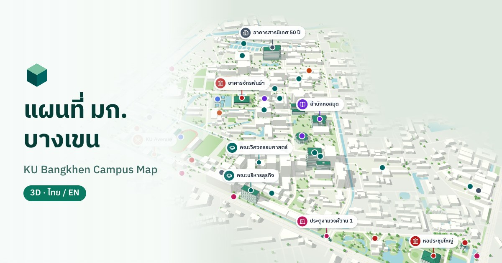

# KU Campus Map · แผนที่มหาวิทยาลัยเกษตรศาสตร์ บางเขน

An interactive 3D map of Kasetsart University's Bangkhen campus, in Thai and
English. It shows faculties, landmarks, food, sport and services, and the KU
shuttle (รถตะลัย) routes. It works on phones (Google Maps-style gestures,
bottom sheets) and on desktop.



- **Map:** real campus geometry from OpenStreetMap, styled as a low-poly isometric scene. 16 key landmarks have detailed models.
- **Search:** Thai and English, with nicknames, plus category filter chips.
- **Places:** tap a place to fly to it and open details: photos with attribution, a description, and sources.
- **Shuttle:** an overlay of lines 1, 3 and 5, traced from KU's official route maps, with stops, hours and line highlighting.
- **Static site:** no backend, so it deploys to Vercel or GitHub Pages.

Stack: Vite, React 19, TypeScript, three.js via @react-three/fiber and drei,
Tailwind CSS 4, and react-i18next (Thai is the default language).

---

## Setup

Requires Node 20 or later.

```bash
npm install
npm run dev            # http://localhost:5173
npm run dev -- --host  # also reachable from your phone on the same Wi-Fi
npm run build          # production build in dist/
npm run preview        # serve dist/ locally
npm run typecheck
```

## Project layout

```
src/
  data/                  ← content: edit these (no code knowledge needed)
    landmarks.ts         places on the map + their text and photos
    shuttle.ts           shuttle lines, stops, hours
    shuttle-paths.json   traced shuttle routes (generated)
    osm/                 OpenStreetMap data (generated)
  i18n/locales/          UI text in th.json / en.json
  scene/                 3D rendering (three.js / R3F)
  ui/                    React UI (header, search, panels, sheets)
scripts/
  fetch-osm.ts           downloads campus data from OpenStreetMap
  derive-osm.ts          trees, fade mask, compact TopoJSON for the app
  shuttle/trace_routes.py  traces shuttle routes from KU's route maps
tests/e2e/               interaction tests (Playwright)
TODO-images.md           places still needing a photo
```

All UI text lives in `src/i18n/locales/*.json`. Components don't hardcode Thai
or English strings.

---

## Editing content

### Landmarks: `src/data/landmarks.ts`

Each place is one entry:

```ts
{
  id: 'library',                       // stable, URL-safe; used in ?place=library
  category: 'library',                 // faculty | food | sport | library | admin | transport | landmark | gate
  featured: true,                      // optional: gets a detailed 3D model + label priority
  coordinates: { lat: 13.848107, lng: 100.571813 },
  coordSource: 'osm',                  // osm | derived | manual
  osmId: 'way/336752159',              // optional
  name:      { th: 'สำนักหอสมุด', en: 'KU Library' },   // full name (detail panel)
  shortName: { th: '…', en: '…' },     // optional: compact map label (never truncated)
  description: { th: '…', en: '…' },   // 2–3 short factual sentences
  images: [ … ],
  searchAliases: ['หอสมุด', 'ห้องสมุด', 'library'],      // nicknames / other spellings
  sources: ['https://…'],              // where the facts came from
  notes: '…',                          // editorial notes, not shown in the UI
}
```

- **Text:** edit `name`, `shortName` and `description` in both languages.
  Keep `shortName` short, because map labels are never cut off.
- **Search:** add nicknames, abbreviations and alternate spellings to
  `searchAliases`. Matching ignores case, spaces and punctuation, and Thai
  matches anywhere inside a word.
- **Moving a pin:** paste a hand-checked lat/lng and set `coordSource: 'manual'`.
- **Adding a place:** copy an entry, give it a new `id`, and add `sources`.
  Two official KU landmarks are waiting for coordinates at the bottom of the
  file (พระพิรุณทรงนาค, หออนุสรณ์ 60 ปี). Paste coordinates in and move them
  into the list.
- **Detailed 3D model** (optional): add the landmark to
  `src/scene/modelSpecs.ts` with its OSM building id(s) and a style.

### Photos

Photos must be openly licensed or your own. Every photo carries its author,
licence and source, and the detail panel displays them.

**Your own photo (one line):**

1. Save it as `public/images/landmarks/<id>.jpg` (landscape, about 1600 px
   wide, under about 300 KB).
2. Add it to that landmark in `src/data/landmarks.ts`:

   ```ts
   images: [own('Your Name', 'CC BY 4.0')],
   ```

   `own()` fills in the file path from the landmark's `id`. Pass a third
   argument to use a different file name.
3. Remove the landmark's row from `TODO-images.md`.

**A Wikimedia Commons photo:**

```ts
images: [commons('File name on Commons.jpg', 'Author', 'CC BY-SA 4.0')],
```

Images load lazily. A landmark without photos shows a styled placeholder.

### Shuttle: `src/data/shuttle.ts`

- **Lines:** `name`, `summary`, `color`, `service` (buses and hours per day),
  `notes`, and `stops`, the ordered list of stop ids.
- **Stops:** `code` (as printed on KU's map), `name {th,en}`, `coordinates`,
  `coordSource` (`osm` or `official-map`), and `offMap` for stops outside
  this map.
- Which lines serve a stop is worked out from the lines' `stops` lists, so
  there's nothing to keep in sync by hand.

The route **paths** in `shuttle-paths.json` are generated. If KU publishes new
route maps:

```bash
mkdir -p .cache/shuttle && cd .cache/shuttle
curl -O https://vehicle.ku.ac.th/index.html/wp-content/uploads/2022/06/bus1.jpeg   # and bus3, bus5, bus_way
cd ../..
python3 scripts/shuttle/trace_routes.py .cache/shuttle src/data/shuttle-paths.json --debug /tmp/trace.png
```

This needs Python 3 with Pillow, numpy and scipy. Compare the `--debug`
render with the official maps. Fix anything wrong with the reviewed
`EXCLUDE` and `FORCE_LINKS` lists at the top of the script, then re-run.
Image URLs and filenames will change with new maps, so update the
`CONTROL_PX` pixel positions for the gate markers too.

> Current data: route maps dated **1 March 2022**; service hours from KU's
> **2026** schedule. The UI states this. For live bus positions, use KU's
> *KU Talai* app.

### Re-fetching OpenStreetMap data

```bash
npm run fetch-osm     # downloads from Overpass, writes src/data/osm/*.json, then runs derive-osm
npm run derive-osm    # only regenerate trees, the fade mask and campus.topo.json (offline)
```

`fetch-osm` keeps the raw per-layer GeoJSON as the source of truth.
`derive-osm` writes `campus.topo.json`, the compact quantised TopoJSON the app
actually loads. Context features more than 270 m outside the campus are
dropped (they're fully faded on screen anyway). The campus area is the union
of OSM ways 38001215 (main campus), 589752219 and 589752221 (the veterinary
parcel). Commit the regenerated files.

Map data © OpenStreetMap contributors, ODbL. The attribution is always
visible in the app.

---

## Tests

Interaction tests run against the dev server and use the dev-only
`window.__kuMap` hooks:

```bash
npm run dev -- --port 5179     # in another terminal
npm run test:touch             # Google Maps-style multi-touch gestures (CDP touch input)
npm run test:desktop           # mouse, wheel, keyboard
npm run test:webkit            # Safari engine (one-time: npx playwright-core install webkit)
npm run test:search            # search, filters, back-gesture history, sheet snaps
npm run test:shuttle           # shuttle overlay, lines, stops
```

You need Google Chrome installed. Set `MAP_URL` to test another address.
These tests complement checking on real phones; they don't replace it. See
`tests/e2e/README.md` for details.

## Performance

The UI shell (124 KB gzipped) paints first. three.js, the scene and the map
data (360 KB gzipped) load afterwards in a separate chunk, behind a loading
skeleton. The scene builds in several short tasks, renders only on demand
(nothing while idle), and caps the pixel ratio on phones. Measurements are in
`docs/performance.md`.

---

## Deploying

### Vercel

1. Import the repository in Vercel. It detects Vite; `vercel.json` sets the
   build command, output directory, SPA rewrites and asset caching.
2. Under Project → Settings → Environment Variables, set **`VITE_SITE_URL`**
   to your production URL with no trailing slash (for example
   `https://ku-map.vercel.app`). Link previews in LINE, Facebook and X need
   absolute image URLs. The value in `.env` is only a placeholder: builds on
   Vercel or CI **fail** while it is unchanged, and local builds print a warning.
3. Deploy. Deep links like `https://<site>/?place=library` open that place
   directly.

### GitHub Pages

1. Push to GitHub, then go to Settings → Pages → Source and choose
   **GitHub Actions**.
2. `.github/workflows/pages.yml` builds on every push to `main` with
   `BASE_PATH=/<repo>/` and the matching `VITE_SITE_URL`, then publishes `dist/`.
3. The site is at `https://<user>.github.io/<repo>/`.

To build for a sub-path manually:
`BASE_PATH=/ku-map/ VITE_SITE_URL=https://<user>.github.io/ku-map npm run build`.

---

## Credits and licences

- Map data © [OpenStreetMap contributors](https://www.openstreetmap.org/copyright) (ODbL).
- Shuttle routes, stops and hours: Kasetsart University, Office of Physical
  Plant and Sustainable Environment ([vehicle.ku.ac.th](https://vehicle.ku.ac.th/index.html/)).
  The routes were traced from the official maps and may be slightly off.
- Photos: Wikimedia Commons contributors, credited per photo in the app.
- Landmark facts: ku.ac.th and Wikipedia, cited per landmark in `sources`.
- Font: IBM Plex Sans Thai (SIL Open Font License).

This is an unofficial project, not affiliated with or endorsed by Kasetsart University.
