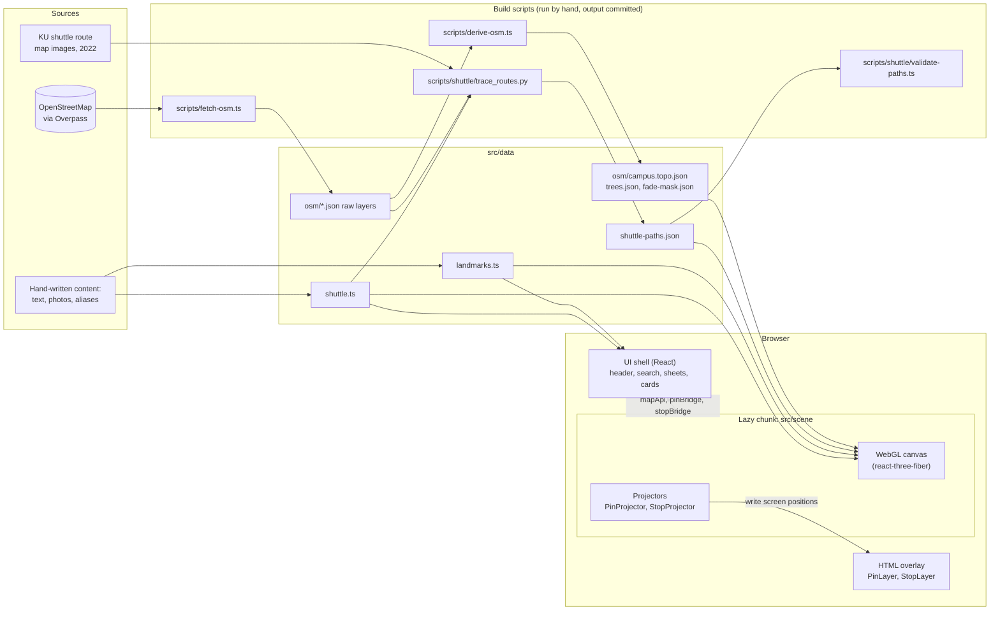
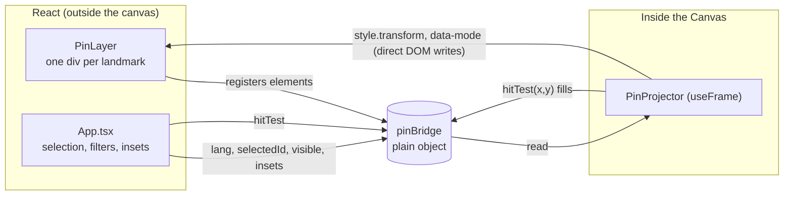
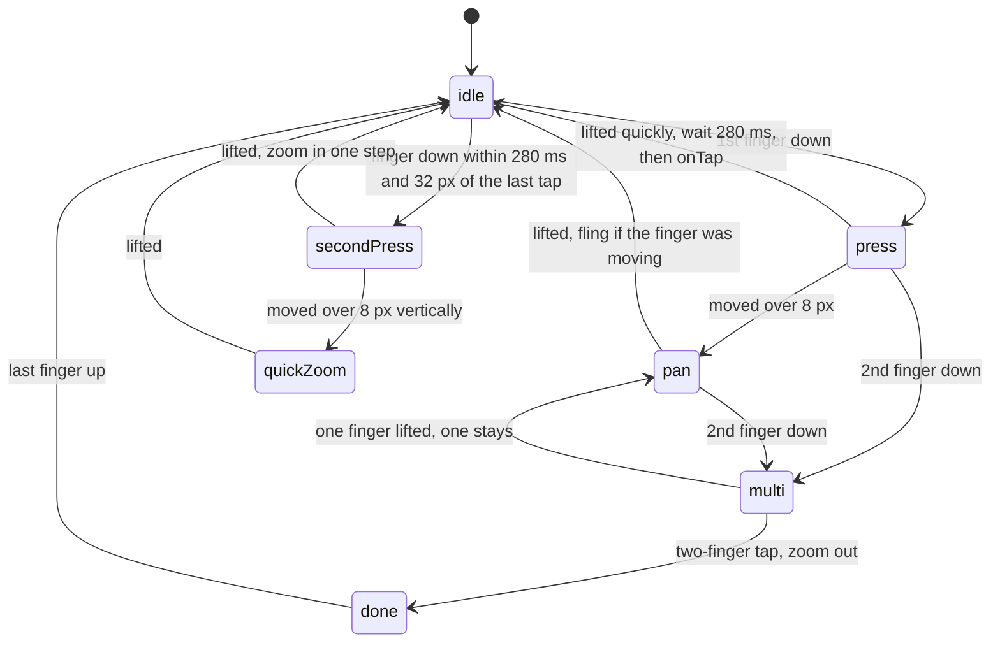
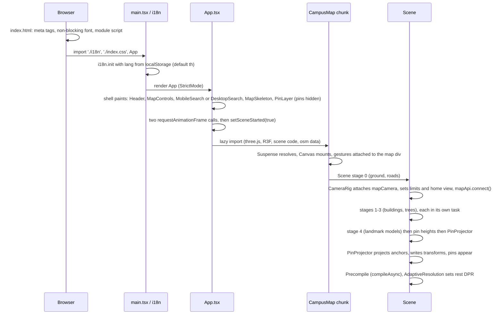
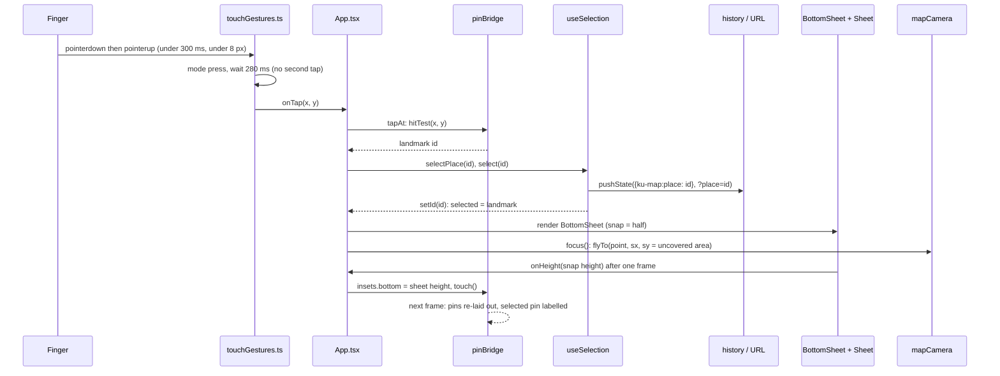

# Architecture

How the KU Campus Map works, written for someone who knows programming but is new to three.js. File and function names are real; follow them into the code. Where something is uncertain, or I'm inferring a reason that the code doesn't record, I say so.

Contents: [1 Big picture](#1-big-picture) · [2 Coordinates](#2-coordinate-system) · [3 Scene rendering](#3-scene-rendering) · [4 Pins, labels, stops](#4-pins-labels-and-shuttle-stops) · [5 Input](#5-input) · [6 State and navigation](#6-state-and-navigation) · [7 Search](#7-search) · [8 Shuttle](#8-shuttle) · [9 Performance](#9-performance) · [10 Testing](#10-testing-strategy) · [11 Walkthroughs](#11-walkthroughs) · [12 Glossary and decisions](#12-glossary-and-decision-log)

---

## 1. Big picture

There is no server. Everything the browser needs is built ahead of time or committed to the repo.



Four ideas hold the design together:

1. **Content is data, not code.** `src/data/landmarks.ts` and `shuttle.ts` hold text, coordinates and sources; components only read them. UI strings are in `src/i18n/locales/*.json`.
2. **The 3D map is generated from OSM at runtime, from committed files.** The app never calls Overpass. `campus.topo.json` is decoded into GeoJSON by `src/data/osm.ts` and turned into meshes by `src/scene/`.
3. **Labels and pins are HTML, not 3D.** A projector inside the canvas computes where each anchor falls on screen and writes `transform` styles on DOM elements. See [section 4](#4-pins-labels-and-shuttle-stops).
4. **The camera is one object (`mapCamera`)** that touch gestures, animations and UI buttons all drive. See [section 5](#5-input).

The scene is a separate bundle: `App.tsx` loads it with `lazy(() => import('./scene/CampusMap'))`, so the header and search appear before three.js has downloaded. `src/ui/` and `App.tsx` never import three.js; they talk to the camera through `src/scene/mapApi.ts`, which has no three.js dependency.

---

## 2. Coordinate system

OSM gives longitude/latitude in degrees. three.js works in unitless numbers, and this project makes **1 unit = 1 metre**.

`src/lib/geo.ts` does the conversion:

```ts
project(lng, lat) → [east, north]   // metres from ORIGIN
toScene(lng, lat) → [east, -north]  // scene (x, z)
```

- **Origin:** `ORIGIN` is `origin` in `src/data/osm/meta.json`: the centroid of the main campus polygon (about 13.8471° N, 100.5698° E). Everything is measured from there.
- **Why local metres:** floating-point numbers lose precision far from zero (GPUs use 32-bit floats), and degrees aren't metres. Re-centring on the campus keeps every coordinate under about ±1500 and lets you reason in metres (a 9 m road is `9`).
- **Projection:** equirectangular: `x = Δlng · R · cos(lat₀)`, `y = Δlat · R` (with `R = 6378137`, `cos(lat₀)` taken at the origin). Over a ~2 km campus the error is negligible (the comment in `geo.ts` says so; I haven't measured it).
- **Axes:** three.js is Y-up. East = **+x**, up = **+y**, **north = −z** (so scene z grows to the south). That is why `toScene` negates north.
- **2D shapes:** polygons are authored in an (east, north) plane (`polygonsOf()` in `src/scene/geometry.ts` returns projected rings), turned into `THREE.Shape`, then laid flat by one rotation `LAY_FLAT = rotateX(-90°)`, which maps (east, north, 0) to (east, 0, −north).
- **Camera angles** (`src/scene/camera/mapCamera.ts`): the camera orbits a *target* on the ground. `azimuth` is measured around +Y from +z (0 = camera south of the target, so north is up on screen); `polar` is the angle from +Y (0 = straight down). The default view is 42° above the ground (`DEFAULT_ELEVATION` in `CampusMap.tsx`), allowed range 28°–54°.
- **The shuttle tool uses the same projection** in Python (`proj()` in `trace_routes.py`) with the same origin read from `meta.json`.

---

## 3. Scene rendering

### three.js in five sentences

A **scene** holds objects; each visible object is a **mesh** = a **geometry** (vertices and triangles) plus a **material** (how its surface is shaded); a **camera** says where we look from; the **renderer** draws the scene as seen by the camera onto a canvas using the GPU. Each mesh costs at least one **draw call**, and draw calls are expensive, so this project merges thousands of buildings into a handful of meshes. [react-three-fiber](https://r3f.docs.pmnd.rs) (R3F) lets you write that scene as React components (`<mesh geometry={…} material={…} />`) and owns the render loop; `<Canvas>` in `CampusMap.tsx` creates the renderer, scene and camera.

### What is drawn (`src/scene/CampusMap.tsx`, `Scene()`)

| Layer | Source | Where | How |
|---|---|---|---|
| Ground, campus plate, lawns, parks, pitches, track, water, canals, pools, roads, paths, centre-line dashes | OSM `boundary`, `green`, `sport`, `water`, `roads` | `BaseLayers.tsx` | `flatPolygons()` (flat shapes at a tiny height) and `ribbons()` (a polyline widened into a strip with mitred joins and end discs) in `geometry.ts`; one merged mesh per layer |
| Plain buildings | OSM `buildings` | `BuildingBlocks` in `BaseLayers.tsx` | `extrudedPolygons()` raises each footprint to `buildingHeight(f)`; all merged into one mesh inside the campus and one outside; walls and roofs coloured per vertex by `colorByFacing()` |
| ★ landmark models (16) | `modelSpecs.ts` + OSM footprints | `models.ts`, `LandmarkModels.tsx` | see below |
| Trees | `trees.json` | `Trees.tsx` | instanced meshes |
| Shuttle routes | `shuttle-paths.json` | `ShuttleLayer.tsx` | ribbons drawn only when the overlay is on |

**Heights.** `heights.ts`: use OSM `height`, else `building:levels × 3.6 + 1`, else a default per building type, else a stable pseudo-random 9–13 m from a hash of the id (so unlabelled blocks vary). Then multiply by `HEIGHT_SCALE = 1.5`: real heights look flat at campus scale. Landmarks get a further `LANDMARK_BOOST = 1.15`. All of this is an artistic choice, not real height.

**Flat layers and z-fighting.** Ground layers are almost coplanar, and the GPU can't reliably decide which of two nearly equal depths is in front (z-fighting). So flat materials are created with `depthWrite: false` and each mesh gets an explicit `renderOrder`; they are painted bottom to top in the order of `flatLayers` in `BaseLayers.tsx`.

**Landmark models.** `modelSpecs.ts` is a declarative table: for each ★ id, a `kind` (`building`, `stadium`, `pool`, `monument`, `gate`) and the OSM building ids it replaces. Those footprints are removed from the plain-block mesh (`modelledBuildingIds`) and rebuilt by `buildLandmarkModels()` in `models.ts` out of primitives (`prism`, `loft`, `hipRoof`, `orientedBox`, `offsetRing` in `geometry.ts`) in a style (`modern`, `hip`, `thai`, `hall`, `pavilion`, `canopy`). Parts go into **buckets** (`wall`, `roof`, `trim`, `plinth`, …, 13 in all), one merged mesh and material per bucket. Crisp outlines come from `EdgesGeometry(g, 25)`. `buildLandmarkModels()` also returns each model's top height (`tops`), which `pinHeights()` (`pinAnchors.ts`) uses so a pin floats above the roof. The gate and monument models derive their orientation from the nearest road / a neighbouring building.

**Trees.** `scripts/derive-osm.ts` writes `trees.json` as a flat array (stride 4: lng, lat, scale×100, kind). The 38 real OSM trees come first; the rest are *decorative*: candidates on a 6 m grid kept with a probability from distance to roads, water and green areas, modulated by low-frequency noise so they clump, using a seeded PRNG (so regenerating doesn't change the file). They are **not surveyed positions**. `Trees.tsx` renders 3 canopy shapes plus trunks as four `InstancedMesh`es: one draw call per shape no matter how many trees (1,078 in the current data), with per-instance colour from `palette.canopy`.

### Materials and the campus edge fade

`materials.ts` uses `MeshLambertMaterial` (cheap per-vertex diffuse lighting, a good fit for flat-coloured low-poly). Every material is passed through `withCampusFade()` (`campusFade.ts`), which injects GLSL into the built-in shader through `onBeforeCompile`:

- the vertex shader passes the world x/z of each vertex to the fragment shader;
- the fragment shader looks that position up in a small texture (`fade-mask.json`: a 160×160 grid, written by `derive-osm.ts`, holding "distance outside the campus ÷ 260 m") and mixes the pixel colour toward the sky colour. The result is the soft vignette that follows the real campus outline.

All patched materials share the same uniform objects; `customProgramCacheKey` tells three.js the patched shaders can share compiled programs. Landmark walls get a second patch, `windowBands()`, that paints a glass-coloured band on every storey (from `fract(worldY / floor)`) so towers read as buildings without textures.

**Lighting** (`CampusMap.tsx`): one `hemisphereLight` and one `directionalLight` (the sun, from the west so shadows fall to the right in the default view), with tone mapping off (`NoToneMapping`) so palette colours come out as authored. The comment in `Sun`/`materials` notes that three's Lambert divides light by π, hence intensities of 1.73 and 1.92. The sun's shadow camera follows the view target and shrinks when zoomed in (half-width `clamp(distance × 0.6, 160, 1300)`), giving sharper shadows; shadow map 4096² on desktop, 2048² on touch devices (`isCoarse`).

### Staged build and render-on-demand

`Scene()` builds in stages (`useStage(4)`): ground and roads first; then campus buildings; outside buildings; trees; finally landmark models and the pin projector. Each stage runs in its own `setTimeout(0)` task so the browser can paint and respond between them instead of one long freeze.

The canvas uses `frameloop="demand"`: it renders a frame only when something calls `invalidate()` (camera moved, overlay toggled, resolution changed). A still map draws **nothing** (`docs/performance.md` records 0 frames while idle, verified). `mapCamera.write()` and the projectors call `invalidate()` when state changes.

### Adaptive resolution (`src/scene/quality.tsx`)

The canvas has a *DPR* (device pixel ratio, rendered pixels per CSS pixel). An iPhone 13 is 3; rendering all 9 pixels per CSS pixel on every frame is too much for a phone GPU, and a fixed lower value makes the still image blurry. So:

- **At rest:** `REST_DPR = min(devicePixelRatio, 3 on touch / 2 on desktop)`. Free, since nothing is drawn while still.
- **While moving:** `AdaptiveResolution` notices camera movement (matrix change or `mapCamera.active`) and switches to `MOTION_DPR` (1.25 on phones; unchanged on desktop). A `requestAnimationFrame` loop averages display-frame time; if it exceeds 20 ms for 30 frames, DPR steps down by 0.25 to a floor (0.75 phone / 1 desktop). That value is kept for later gestures.
- **When motion ends:** about 40 ms after the last movement the loop flags `rest`, and at the start of the next frame DPR returns to full and the frame is re-rendered. Changing DPR clears the canvas, so doing it at the start of a frame (rather than between frames) avoids a blank flash.
- `resolution` (exported from `quality.tsx`) is the single source of truth; the Canvas `dpr` prop reads it, because R3F re-applies that prop on every re-render.

---

## 4. Pins, labels and shuttle stops

### Why DOM instead of WebGL

Labels are `<div>`s over the canvas (`src/ui/PinLayer.tsx`, `StopLayer.tsx`), not text in 3D. Reasons (partly inferred, since the project history is the only record):

- Thai text needs correct shaping, tone-mark placement and the web font; the browser does that perfectly and WebGL text (SDF fonts) doesn't, easily.
- Each pin is a real `<button>` with an `aria-label`, so keyboard and screen-reader users can use the map.
- Styling (icons, rings, hover, selection) is ordinary CSS, and labels stay crisp at any DPR because they aren't rendered into the canvas.

The cost is that every camera change must move every pin: the projector below. The DOM layers are **pointer-transparent** (`pointer-events-none`): touches and clicks always reach the map, and selection goes through `hitTest`, so dragging over a label still pans.

### The bridge/projector pattern



`src/scene/pinBridge.ts` is a plain mutable object, not React state. It exists because the two sides live in different worlds: React components outside the `<Canvas>` and a per-frame loop inside it. The bridge carries:

- `elements`: the DOM nodes (PinLayer registers them with a ref callback);
- inputs: `lang`, `selectedId`, `visible` (the category filter), `insets` (screen areas covered by floating UI), `fitDistance`;
- output: `hitTest(x, y)`, set by `PinProjector`;
- `dirty` and `touch()`: "something other than the camera changed", which also calls `invalidate()`.

`PinProjector` (`Pins.tsx`) runs in `useFrame`. It **returns early unless something changed** (the camera matrix differs from last time, the size changed, or `pinBridge.dirty`). When it runs, per landmark it projects the 3D anchor (landmark position, raised to its roof height) to screen pixels with `Vector3.project(camera)`, decides a mode, and writes the result straight to the element. React never re-renders for camera movement. Writes are diffed: a pin whose mode and position didn't change isn't touched, and hidden pins are skipped.

### Label priority and collision

Each pin is `label` (icon chip + short name + stem + dot), `dot`, or `hidden` (off-screen, filtered out, or under floating UI). The decision in `PinProjector`:

1. Order pins: selected first, then `featured` (★), then the rest (`rank`; re-sorted only on non-camera changes such as selection, language or filters).
2. A **label budget by zoom** (`labelBudget`, with `zoom = distance ÷ fitDistance`): zoomed out (>0.6) at most 10 labels and only ★; mid (>0.3) at most 18 and anyone; zoomed in, no limit.
3. Walk the ordered list, placing greedily: a chip is a rectangle (width measured from the text with a canvas `measureText` and cached per language/font state, plus padding; height 32 + 14 stem). It is placed if it lies fully inside the viewport and outside the `insets` and overlaps no already-placed label; the selected pin skips the overlap test (but still has to fit on screen). Everything else stays a dot.

This is a simple greedy rectangle packing: O(n²) over ≤38 pins, trivially cheap, and it only runs when the camera moves.

### Hit-testing

Because pins are pointer-transparent, `pinBridge.hitTest(x, y)` decides what a tap meant: a point inside a label's chip rectangle wins; otherwise the nearest dot within a 24 px radius (`DOT_HIT_RADIUS`; a fingertip is bigger than a 12 px dot). Shuttle stops work the same way (`stopBridge.hitTest`, 18 px radius) and are checked first when the overlay is on (`tapAt` in `App.tsx`).

### Shuttle stops

`StopLayer` / `StopProjector` / `stopBridge` are the same pattern for the 51 on-map stops, with two modes (`shown`/`hidden`) and no collision. Visibility comes from `stopBridge.visible`, set in `App.tsx` from the overlay state and the selected line. The route lines themselves are real 3D (`ShuttleLayer.tsx`), since they have to lie on the roads.

---

## 5. Input

### Two input systems, split by pointer type

- **Touch** is handled by `src/scene/camera/touchGestures.ts`, a hand-written recogniser on Pointer Events. `attachTouchGestures(el, …)` listens on the map container in the **capture phase** and calls `stopPropagation()` for touch pointers, so OrbitControls and the pins never see them. Mouse and pen fall through.
- **Mouse and keyboard** use drei's `<OrbitControls>`: left-drag pans, right-drag rotates, wheel zooms (`mouseButtons` in `CampusMap.tsx`), with damping, minimum distance 90 m, maximum = the distance that frames the campus × 1.35, and the 28°–54° tilt limits. `CameraRig` clamps the target to the campus bounds plus 120 m each frame.

Why not use OrbitControls' own touch support? The goal was Google Maps' behaviours: pan with fling, zoom anchored at the finger midpoint, rotate only after a clear twist, tilt with two fingers, double-tap and double-tap-drag zoom, none of which OrbitControls does that way. The cost is ~350 lines of gesture code, covered by `tests/e2e/gestures.mjs`.

### Distinguishing tap, drag and double-tap



The thresholds are constants at the top of `touchGestures.ts`:

- **Tap:** finger down and up in under 300 ms (`TAP_MAX_MS`) without moving more than 8 px (`TOUCH_SLOP`). The tap is **not reported immediately**: it waits `DOUBLE_TAP_MS` (280 ms) to see whether a second tap follows. If it does, it's a double-tap zoom and `onTap` never fires; otherwise `opts.onTap(x, y)` fires. (So selecting a pin has a built-in ~280 ms delay.) Touching a gliding map just stops it and doesn't count as a tap.
- **Pan:** once the finger moves 8 px, `mapCamera.panScreen(x0, y0, x1, y1)` moves the camera so the ground point under the finger stays under it. The last ~90 ms of movement gives a velocity; if the finger was still moving when it lifted (<60 ms), `mapCamera.fling()` continues the motion.
- **Pinch / twist / tilt** (`multiMove`): each component engages only after it clearly starts, then follows the fingers 1:1 with no jump: zoom after the span changes by `|log(span/start)| > 0.045`, rotation after a 12° twist, tilt when both fingers move ≥12 px vertically in the same direction. Tilt is exclusive with zoom and rotation.
- Timing uses `e.timeStamp` (event time), not handler time, so a slow frame can't turn a double-tap into two taps. A third finger is ignored. On iOS, `gesturestart/change/end` are cancelled so the page doesn't zoom or bounce. The browser's follow-up `click` after a touch is swallowed so a tap never selects twice.

### The camera API (`mapCamera.ts`)

`mapCamera` (a single `MapCamera` instance) is the only thing that moves the camera outside desktop mouse input. Its design choice: **the camera object is the source of truth.** `read()` derives `{ target, distance, azimuth, polar }` from the camera and OrbitControls' target; `write()` sets the camera from that state. Nothing keeps a separate copy, so OrbitControls and the gesture code can never disagree.

- `begin()/end()` count "holds"; while held, `controls.enabled = false` so OrbitControls doesn't fight the gesture. `active` is true while a gesture, fling or animation owns the camera.
- `panScreen`, `transform({factor, dAzimuth, dPolar, anchor…})`: direct manipulation. `groundAt(sx, sy)` ray-casts a screen point onto the ground plane (y = 0); anchoring means "the ground under (ax, ay) must end up under (bx, by)".
- Limits are soft: pushing past the bounds, zoom range or tilt range meets rubber-band resistance (`resistance()`), and `settle()` animates back inside when the gesture ends.
- Animations (`run()`): `zoomStep`, `animateTo` (with a small pull-back arc on long trips), `flyTo(point, {distance, sx, sy})` (solves the target so the point lands at a given screen position, used to keep a selected place clear of cards and sheets), `resetBearing`, `goHome`. With `prefers-reduced-motion` they jump to the end.
- `mapApi.ts` is a thin, three-free facade over it for the UI (`zoomStep`, `goHome`, `flyTo`, `subscribe` for the compass). It exists so the UI shell can load before the scene does.

On desktop, a plain click (mouse moved < 5 px) is turned into the same `tapAt` call by an effect in `App.tsx`.

---

## 6. State and navigation

### Where state lives

There is no state library; `App.tsx` holds it with hooks:

| State | Owner | Notes |
|---|---|---|
| selected place | `useSelection()` (`ui/useSelection.ts`) | mirrored in the URL `?place=<id>` |
| selected shuttle stop, overlay on/off, active line | `useState` in `App` | a stop and a place are never open together |
| category chips | `useState` in `App` | `visibleCategories()` (`ui/filters.ts`) → `pinBridge.visible` |
| search sheet open (mobile) | `useHistoryFlag('ku-map:search')` | backed by a history entry |
| language | i18next + `localStorage` (`ku-map.lang`) | `src/i18n/index.ts`; also sets `<html lang>` and the title |

Per frame data (camera, pin positions) is deliberately **not** React state; it flows through the bridges.

### `?place=`, history and the back gesture

`useSelection()` stores the selection in the URL and in `history.state`:

- Opening a place from nothing **pushes** a history entry (`{ 'ku-map:place': id }`, URL `?place=id`), so the phone's back gesture pops that entry and closes the sheet instead of leaving the site.
- Switching places **replaces** the entry (so one back closes the whole thing).
- Closing (`select(null)`) calls `history.back()` when the current entry is the app's own; the resulting `popstate` clears the selection. Otherwise it just clears the id and the URL.
- A **deep link** (`/?place=library` on first load) is rewritten: the clean URL becomes the base entry and a `?place` entry is pushed on top, so back goes to the plain map rather than leaving.
- `popstate` re-reads the URL, so browser back/forward always agree with the screen.

`useHistoryFlag(key)` does the same for the mobile search sheet. With a place opened from search, the stack is *map → search → place*: back closes the place and returns to search; back again collapses search (`tests/e2e/search.mjs`).

### Desktop card vs mobile sheet

`useMediaQuery('(min-width: 768px)')` (`DESKTOP_QUERY`) picks the layout.

- **Desktop:** the header holds the search and the category chips. A place opens a `DetailCard`, a shuttle stop a `StopCard`; both are fixed to the right, **left of a reserved controls column** (`src/ui/layout.ts`: `CONTROLS_RESERVE = 72`). The map controls never move, and the cards narrow (`cardWidth()`, min 300 px) on small windows so they also clear the shuttle legend on the left.
- **Mobile:** search is a pill at the bottom (`MobileSearch`); a place opens `BottomSheet` (`placeSnaps(vh) = [168, min(vh/2, 460), vh − 76]`: peek, half, full), a stop `StopSheet`, a line `LineSheet`. They are all built on `Sheet.tsx`. Only one bottom surface is shown at a time (`sheetOpen` in `App`).

### The sheet

`Sheet.tsx` is controlled (`snap`, `onSnap`) and can be dragged **from anywhere**. One vertical gesture both moves the sheet and scrolls its content:

- Pointer Events with a direction lock after 8 px: vertical drags are the sheet's; horizontal ones are left to the browser (the photo gallery and chip rows are `touch-action: pan-x` scrollers).
- Below the top snap, dragging up moves the sheet. At the top snap it scrolls the content. Dragging down scrolls the content to its top and then continues moving the sheet in the same gesture.
- This needs the sheet and its content to be `touch-action: none` and **scrolled by script** (`body.scrollTop += …`, plus a momentum loop), because with native scrolling a gesture can't be handed back to the sheet once the browser starts scrolling.
- On release: velocity > 0.5 px/ms steps one snap; otherwise nearest snap; below the lowest snap it calls `onClose`. Past the top it rubber-bands (1/3). A drag that started on a button suppresses the click that follows.

Dismissal by tapping the map goes through `tapAt` (`App.tsx`): a tap on nothing clears the stop, the line (mobile) and the place.

### How the sheet and the map cooperate: insets

The map must not hide a selected pin behind a sheet. Three things use the sheet's size:

1. `Sheet` reports its settled visible height through `onHeight` → `onSheetHeight` in `App` → `pinBridge.insets.bottom`. The projector treats pins in that band as hidden, and won't place a label that doesn't fit above it.
2. `focus(landmark)` in `App.tsx` flies the camera so the place lands in the middle of the *uncovered* area: on mobile between `insets.top` and the sheet's top (at 62% of that span); on desktop between the legend (if shown) and the card.
3. The header's `ResizeObserver` sets `insets.top`; the desktop card sets `insets.right`; the shuttle legend `insets.left`; the collapsed search bar's height is `insets.bottom` when no sheet is open.

---

## 7. Search

`src/lib/search.ts` is plain TypeScript with no dependencies; `src/ui/useSearch.ts` adapts it to React.

- **Index** (`buildIndex`): each `SearchItem` (id, kind landmark|stop, category, `name`, `shortName`, `aliases`, `categoryLabels`) becomes a list of weighted fields: names and short names (weight 1), aliases (0.9), category labels in both languages (0.4).
- **Normalisation** (`normalize`): Unicode NFC, lower case, and all whitespace and `. - · , ( ) ' ’ " /` removed. Thai has no spaces between words, so everything is matched as a **substring**; removing spaces also lets "kuavenue" find "KU Avenue" and "วศ" find "วศ.".
- **Ranking** (`scoreField`): exact match 100; prefix 80; "every query word starts some word of the field" 65 (Latin text: "fac sci" → "Faculty of Science"); substring 45. Score = best field score × field weight, +3 if featured. Category-label matches only count for queries of 2+ characters. Ties go to the shorter Thai name. `search()` takes an optional category set (the chips) and a limit (8).
- **Sources:** `useIndex()` indexes landmarks, plus anything registered with `registerSearchItems()`. `ui/shuttleSearch.ts` registers the on-map shuttle stops at import time (so "E12" or "ป้ายหอสมุด" finds a stop, tagged with a badge). The index rebuilds when the language changes.
- **Empty query:** `useSearchResults` returns up to 8 featured places as "suggested".
- **UI:** `DesktopSearch` implements the combobox pattern (↑/↓, Enter, Esc, "/" to focus); `MobileSearch` is a bar that expands into a sheet; both render `SearchResults`.

There is no fuzzy matching or typo tolerance, and no Thai word segmentation; substring matching is what makes Thai work.

---

## 8. Shuttle

### Data model (`src/data/shuttle.ts`)

- `ShuttleStop`: `id`, optional `code` (E12, S1… as printed on KU's map), `coordinates`, `coordSource` (`osm` = an OSM bus-stop node; `official-map` = read from the georeferenced KU map, approximate), `name`, `offMap`.
- `ShuttleLine`: `id` ('1', '3', '5', 'sr1'), `color`, names/summary, ordered `stops` (stop ids), `path` (polyline from `shuttle-paths.json`), `service` (buses and hours for weekdays/Saturday/Sunday), `notes`.
- `linesByStop` is **derived** from the stop lists, so "which lines serve this stop" can't drift out of sync.
- Counts: 58 stops (39 from OSM, 19 from the official map; 7 of them `offMap`, i.e. the dorm stops E19–E25), 3 lines with routes and one without (ศร.1).

### How routes were produced (`scripts/shuttle/trace_routes.py`)

KU publishes route maps as illustrations (JPEGs), not GIS data. The tool turns them into polylines that lie on OSM roads:

1. **Georeference** each map image: an affine fit from pixel to metres using 5 control points (four gate markers and the Hexagonal Pavilion stop), refined by ICP (iteratively matching the navy "route ink" pixels to the nearest OSM road), then a quadratic warp, then a smooth non-rigid correction (a Gaussian-weighted mean of the local residual) to absorb the illustration's distortion. The script prints the remaining error (median distance from route ink to the nearest road): about 1.5–1.8 m for lines 1 and 3 and about 7 m for line 5, whose map aligns less well.
2. **Road graph:** OSM drivable roads inside the campus area (the three campus polygons plus 10 m, `AREA_TOL`), plus a short reviewed list of KU roads the polygons miss (`outside-roads.json`, currently one: the bend to the Vet Tech stops). Public roads (primary/secondary/…, Ngamwongwan, Phahonyothin, Vibhavadi) are never allowed.
3. **Cost:** each road segment costs its length × (1 + 8 × (1 − ink coverage)), so roads the official line is drawn on are cheap and off-route roads expensive. One-way roads can be driven backwards only at 4× cost.
4. **Route:** a Dijkstra search over (node, previous node, stops visited) finds the cheapest loop through the line's stops **in order** from `shuttle.ts` and back to the first, with a U-turn penalty (250 m-equivalent), trying each candidate road for each stop (a stop between two carriageways can attach to either). The result is **one continuous polyline per line**. `STOP_ROADS` pins stops whose road can't be told from position (E8, E9).
5. `--debug` renders each route over its official map image, and a top-down OSM view; they must be reviewed by eye.

This replaced an earlier approach that marked roads covered by the ink and stitched them; it left stretches on public roads and visible gaps, which is what the validator below now guards against.

### Validation (`scripts/shuttle/validate-paths.ts`)

Run by `npm run test:shuttle-data` (and first by `npm run test:shuttle`). It fails if, for any routed line: a vertex is more than 10 m outside the campus area (unless on that line's reviewed outside road); a step runs along a public road; a step leaves the road network by more than 5 m (a gap); the loop doesn't close; or a stop (not `offMap`) is more than 30 m from the path. Run against the old routes (their pieces joined end to end) it reported 126 problems.

### Drawing (`ShuttleLayer.tsx`)

Each line is a flat ribbon just above the road. The ribbon is built once at a fixed width; a vertex shader (`aSide`, `uWidthScale`) widens it with camera distance (clamped 0.7×–4.5×) so lines stay readable at every zoom. Lines are 9 m (line 5), 6 m (3) and 3.2 m (1) wide at the reference distance so that shared roads show concentric stripes; all white casings are drawn first, then lines widest to narrowest; the selected line is drawn last and the others dim. `drawRuns()` draws each road stretch once and splits at U-turns, so the out-and-back of a two-way road doesn't draw twice.

### Known data gaps

These are properties of the *data*, repeated in the README's open items:

- Route maps are from March 2022; the schedule poster is from 2026. The UI says so (`shuttle.disclaimer`). Changes since 2022 are unknown.
- Line 5's dormitory section (E19–E25) is outside the map and not drawn; its stops list as "off-map".
- Names of stops that aren't printed on KU's map are neutral labels ("ป้าย E22 (โซนหอพักนิสิต)", "ใกล้…"), not invented names.
- 19 stop positions came from the illustration and are approximate; E8 was moved to the nearest road point (noted in its `notes`).
- Line 3 has no Sunday service on the schedule; the evening 18:30–21:30 service isn't attributed to lines; ศร.1 has no route and no stated days; S7 is on no line.
- Line 5's route on the east trunk and its stop order are approximate (the official map draws two parallel strokes, one per direction).

---

## 9. Performance

Every item: why it exists, and what it costs. Numbers are in `docs/performance.md` (Lighthouse and frame costs; frame costs were measured on a Mac GPU in iPhone emulation, **not on a phone**).

| Optimisation | Where | Why | Trade-off |
|---|---|---|---|
| Lazy scene chunk | `lazy()` in `App.tsx`; `MapSkeleton` | The UI shell (124 KB gz) paints first; three.js + scene + data (360 KB gz) load after two animation frames | A brief skeleton screen; the first paint is not the map |
| Staged scene build | `useStage` in `CampusMap.tsx` | No single long main-thread task (each ≤ ~300 ms) | Total work unchanged: Total Blocking Time didn't improve |
| TopoJSON + quantisation + trimmed properties | `derive-osm.ts`, `src/data/osm.ts` | Map data 77 KB gz instead of ~138 KB; decoded to GeoJSON at runtime | Coordinates are quantised to ~2.5 cm; names and extra tags aren't in the runtime file (they stay in the raw files) |
| Context features beyond 270 m dropped | `derive-osm.ts` | They're fully faded on screen anyway | None visible |
| Merged geometry | `geometry.ts` (`mergeGeometries`) | ~60 draw calls instead of thousands | You can't move one building at runtime |
| Instanced trees | `Trees.tsx` | 4 draw calls for 1,078 trees | Per-tree changes need matrix updates |
| Render on demand | `frameloop="demand"` | 0 frames while idle: battery and heat | Anything that changes the picture must `invalidate()` |
| Adaptive resolution | `quality.tsx` | Sharp at rest, cheap while moving | Slightly soft image during motion; one extra full-resolution frame at the end |
| Shadow map redrawn only at rest | `Sun` in `CampusMap.tsx` | The shadow pass cost 13 extra draw calls per frame | While moving, shadows stay fixed in the world (correct), but zooming far out can reveal unshadowed edges until the map stops |
| Shadow map 2048² on touch | `isCoarse` | Cheaper to render and to look up | Softer shadow edges |
| No backdrop blur on touch devices | `perf.ts`, `index.css` | iOS Safari re-blurs the canvas behind each blurred element every frame (a known cost; not measurable in Chrome) | Surfaces are 90–97% opaque instead of blurred glass |
| DOM writes diffed, hidden pins skipped | `Pins.tsx`, `StopProjector.tsx` | Style recalculation was ~1.5 ms/frame at 4× CPU throttle | Slightly more code |
| Projectors run only on change | `Pins.tsx`, `StopProjector.tsx` | No work when the camera is still | A `dirty` flag to remember |
| Shader precompile | `Precompile` in `CampusMap.tsx` (`compileAsync`) | Avoid shader-compile hitches mid-gesture | I haven't measured its effect separately |
| Non-blocking web font | `index.html` | Text paints immediately in a fallback font | A font swap |
| `json.stringify` | `vite.config.ts` | JSON imports become `JSON.parse('…')`, faster than object literals | None |
| One render per display frame, however many touch events | `touchGestures.ts` → `mapCamera` → `invalidate()` | Each touch event does only camera maths (a ray cast and a matrix update) and requests a render; the on-demand loop coalesces requests into one render per frame, so the camera isn't re-rendered per event. The profile (`tests/perf/profile.mjs`) shows script time of about 2–5 ms per frame in total, so this isn't a cost centre; I didn't time a single event | Events between frames only affect the next render |
| MSAA left on | `gl={{ antialias: true }}` | Nearly free on tile-based phone GPUs; keeps moving frames from looking jagged | Costs some GPU on desktop |

`?debug=1` (`ui/DebugOverlay.tsx`, state in `lib/perf.ts`, stats written by `PerfProbe` in `quality.tsx`) shows FPS, display-frame time, CPU time per frame, DPR, draw calls and triangles, and toggles shadows, blur, pins, stops and trees and a resolution cap, to find costs on a real device. `tests/perf/profile.mjs` measures the same in phone emulation.

---

## 10. Testing strategy

The project has **no unit tests** and a deliberate set of end-to-end tests plus one data validator. Reasoning (mine, from how the code is structured): the risky parts are not pure functions. They are *timing and event* behaviour (is this a tap or a double-tap?), the interplay between the WebGL canvas and DOM overlays, browser history, and gestures that depend on real pointer streams. A unit test of `multiMove` with fake numbers would pass while a real two-finger pinch still fails. Pure helpers (`normalize`/`search` ranking, `project`) are only covered indirectly through e2e, which is a real gap.

All e2e suites run against the dev server (they use `window.__kuMap` and `window.__kuGesture`, which exist only when `import.meta.env.DEV`) in Chrome via `playwright-core`.

| Suite | Checks | What it covers |
|---|---|---|
| `tests/e2e/gestures.mjs` (`test:touch`) | 26 | Pan keeps the ground under the finger; fling; pinch anchored at the midpoint; no accidental rotate/tilt; 12° twist threshold; compass; two-finger tilt and its 28°–54° limit; double-tap, two-finger tap, double-tap-drag zoom; taps on pins vs pans starting on pins; rubber band and zoom limits; no page scroll/zoom. Touches are sent through the DevTools protocol with explicit timestamps from a **virtual clock**, so double-tap windows and fling speeds are exact even when slow software rendering makes frames late |
| `desktop.mjs` | 12 | Mouse drag/wheel, click selection, Esc, keyboard Tab+Enter, wheel/drag starting on a pin; controls fixed and uncovered by cards at 768/1024/1440 px |
| `webkit.mjs` | 9 | The same core gestures on the Safari engine (synthetic pointer streams for multi-touch; native touchscreen taps for double-tap and selection); page didn't scroll or zoom |
| `search.mjs` | 20 | "/" focus, ranking, Thai substring, empty state, chips (multi-select, narrowing results), mobile search sheet, back-gesture history, sheet snap heights |
| `sheets.mjs` | 15 | Drag from the body, scroll hand-off in one gesture, gallery swipe doesn't move the sheet, drag on a button, flick to dismiss, tap-outside, tap another pin switches, panning doesn't dismiss, line sheet, search sheet, history cleanup |
| `shuttle.mjs` | 19 | Overlay toggle, line filter, stop search by code, stop cards, mobile line/stop sheets, 375 px line-chip swiping and the close chip |
| `scripts/shuttle/validate-paths.ts` | n/a | Route data rules (section 8); runs first in `test:shuttle` |

Why WebKit separately: Safari handles pointer events, `touch-action` and page zoom differently, and iOS is the main target. Playwright's WebKit has no real multi-touch, so those checks synthesise pointer events; **that is a weaker guarantee than a real iPhone** (and sheet drags aren't run on WebKit at all).

e2e tests can't judge feel, so changes to gestures, sheets and performance are also checked by hand on a phone.

---

## 11. Walkthroughs

### a. Opening the URL until the map is interactive



1. **`index.html`** loads the module `src/main.tsx`; the Google Font is requested with `rel="preload" … onload` so it doesn't block rendering; OG/Twitter meta tags use `%VITE_SITE_URL%` (filled in at build time).
2. **`src/main.tsx`** imports `./i18n` first: `i18n.init` reads `localStorage['ku-map.lang']` (fallback `th`) and sets `<html lang>` and the document title. Then it renders `<App/>`.
3. **`App()`** renders the *shell*: `Header`, `MapControls`, the search UI, `PinLayer` (all pin elements created but `data-mode="hidden"`, `inert`), and `MapSkeleton` in place of the map. This is the first paint (it needs only the 124 KB shell).
4. After **two `requestAnimationFrame`s** (so the shell has painted), `sceneStarted` becomes true and `<Suspense>` renders the lazy `CampusMap`, triggering the download of the scene chunk.
5. **`CampusMap`** mounts `<Canvas>` and, in an effect, `attachTouchGestures(mapRef.current, …)`. From this point touch gestures are live (even before the map is fully built).
6. **`Scene`** renders stage 0 (`BaseLayers`) immediately and advances `stage` with `setTimeout(0)` so later stages are separate tasks. **`CameraRig`** attaches `mapCamera` to the camera and OrbitControls, computes the framing distance (`fitDistance`), sets `mapCamera.limits` and `home`, writes the home pose, and calls `mapApi.connect()`; the UI's `mapApi.ready` and the compass now work.
7. Stage 4 builds the landmark models (`buildLandmarkModels`), then `pinHeights()` computes pin heights from model tops, which mounts `PinProjector`. Its first run (the pins' `touch()` marked them dirty) projects every pin and writes positions and modes: labels and dots appear.
8. `Precompile` compiles every shader; `AdaptiveResolution` sets the at-rest DPR. The map is idle (no frames) until you touch it.

A deep link (`?place=…`) additionally rewrites history in `useSelection`'s initialiser, and an effect in `App` flies to the place once `mapApi.ready`.

### b. Tapping a pin on mobile, until the sheet is open and the URL updated



1. **Touch down/up.** The map container's capture listeners (`onDown`, `onUp` in `touchGestures.ts`) take the pointer events (`stopPropagation`, `setPointerCapture`) and call `mapCamera.begin()`. The finger lifts within 300 ms and 8 px, so `mode === 'press'` ends as a tap: the tap isn't reported yet; a 280 ms timer starts (`tapTimer`).
2. **Timer fires** (no second tap): `opts.onTap(x, y)`. `CampusMap` forwards it through `tapRef` to `App`'s `tapAt`.
3. **`tapAt`** first tries `stopBridge.hitTest` (only if the shuttle overlay is on), then `pinBridge.hitTest(x, y)`: the function `PinProjector` installed, which checks label rectangles and then dots within 24 px. It returns a landmark id, so `tapAt` calls `selectPlace(id)`.
4. **`selectPlace`** clears any selected stop and calls `select(id)` from `useSelection`: `setId(id)`, and, because there is no app-owned history entry yet, `history.pushState({'ku-map:place': id}, '', '?place=id')`. The URL now has `?place=id`, and the phone's back gesture will pop that entry.
5. **React re-renders `App`.** `selected` is the landmark. Because `!isDesktop`, `BottomSheet` renders instead of `DetailCard`; `MobileSearch` is hidden (`sheetOpen`). `PinLayer`'s effect updates `pinBridge.selectedId` and calls `touch()`.
6. **Fly-to.** An effect in `App` (`[selected, focus]`) calls `focus(selected)` once `mapApi.ready`: `mapApi.flyTo(x, z, { distance, sx: w/2, sy: top + (bottom − top) × 0.62 })`, where `bottom` is the sheet's expected top (`sheetHeight` or the half snap). `mapCamera.flyTo` solves the target so the pin lands at that screen point and animates there (950 ms, ease in-out, skipped if reduced motion).
7. **The sheet opens.** `Sheet` starts translated off-screen; one animation frame later `entered` flips and CSS transitions it to the half snap (`snaps[1]`). Its effect then calls `onHeight(snaps[index])`, i.e. `onSheetHeight` in `App`, which sets `pinBridge.insets.bottom` to the sheet height and calls `pinBridge.touch()` (and `stopBridge.touch()`).
8. **Pins re-lay out.** The projector sees `dirty`, re-ranks (the selected pin first, always labelled), hides pins under the sheet, and writes new transforms. The map draws one or more frames during the fly-to.
9. **Closing** reverses it: the close button, a drag below the peek snap, or a tap on empty map calls `select(null)` → `history.back()` → `popstate` → `useSelection`'s `onPop` clears the id → the sheet unmounts, `?place=` is gone, and the effect in `App` that depends on `sheetOpen` sets `insets.bottom` back to the search bar's height.

---

## 12. Glossary and decision log

### Glossary

| Term | Meaning in this project |
|---|---|
| ★ / featured | A landmark with `featured: true`: label priority, and (if it has an entry in `modelSpecs.ts`) a detailed model. 16 of them |
| landmark | One place in `landmarks.ts` (a faculty, a gate…), shown as a pin |
| pin | The DOM element for a landmark; displayed as a **label** (chip + name + stem + dot), a **dot**, or hidden (`data-mode`) |
| stop | A shuttle stop, shown as a ring dot when the overlay is on |
| projector | A component inside the canvas that converts 3D anchors to screen positions each frame (`PinProjector`, `StopProjector`) |
| bridge | A plain object shared between React and the canvas (`pinBridge`, `stopBridge`, and `mapApi` for the camera) |
| insets | Screen areas covered by floating UI (header, card, sheet, search bar); pins and fly-to avoid them |
| hit test | Deciding which pin or stop a screen point means (pins are pointer-transparent) |
| snap / peek / half / full | The resting heights of a bottom sheet |
| holds | `mapCamera`'s counter of who currently owns the camera (gestures, animations) |
| target / distance / azimuth / polar | The orbit state of the camera (see section 2) |
| fling | Continued panning with decaying velocity after the finger lifts |
| rubber band | Resistance past a limit, then spring-back |
| DPR | Device pixel ratio: rendered pixels per CSS pixel. **Rest** and **motion** DPR are the two adaptive values |
| draw call | One GPU command to draw a mesh; the main cost driver |
| bucket | A group of landmark geometry sharing a material, merged into one mesh |
| flat layer | A ground layer drawn without depth writes in a fixed render order |
| ribbon | A polyline widened into a strip of triangles (roads, canals, shuttle routes) |
| campus fade / fade mask | The shader effect that fades everything outside the campus; the precomputed distance texture it reads |
| `coordSource` | Where a coordinate came from: `osm`, `derived`, `manual` (landmarks); `osm`, `official-map` (stops) |
| `offMap` | A shuttle stop outside the map's campus area (listed, not drawn) |
| `shortName` / `searchAliases` | The label text of a landmark / extra words that find it in search |
| `own()` / `commons()` | Helpers that build a local or a Wikimedia Commons photo entry |
| route ink | The navy line pixels on KU's route-map images, used by the trace tool |
| ICP | Iterative closest point: repeatedly matching two point sets and refitting, used to align the route image to OSM |
| `STOP_ROADS`, `outside-roads.json` | Reviewed overrides for the shuttle tracer |
| demand frameloop | R3F mode in which frames are drawn only on `invalidate()` |

### Decision log

The "why" comes from how the code is built, the measurements in `docs/performance.md`, and decisions you made along the way; where it's my inference, it says "(inferred)". "Alternative" is what a reasonable different choice would have been.

| Decision | Reason | Alternative considered |
|---|---|---|
| Fetch OSM once with a script and commit the output | No runtime dependency on Overpass (it is rate-limited and sometimes down); deterministic builds | Fetch at runtime or in the Vite build |
| One quantised TopoJSON for the runtime | 77 KB gz vs ~138 KB for the GeoJSON files | Ship the raw GeoJSON |
| Re-centre coordinates on the campus, 1 unit = 1 m | Float precision and metres you can reason about (inferred) | Use Web Mercator metres |
| Exaggerate building heights 1.5× | Real heights read as flat at campus scale | True heights |
| Plain blocks are merged, low-contrast; landmarks get detailed models | Few draw calls; hierarchy so the ★ places stand out | A mesh per building; textured models |
| Pins and labels as DOM, positioned by a projector | Thai text quality, accessibility, easy styling | Text in WebGL (SDF text) |
| Bridge objects instead of React state for per-frame data | Re-rendering React per camera frame would be slow | Context or a state library |
| Custom touch gesture recogniser | Google Maps behaviours that OrbitControls lacks | OrbitControls touch mode |
| `mapCamera` reads/writes the camera itself (no separate state) | Mouse controls and gestures can't disagree | Own camera state synced to three.js |
| Render on demand | Idle map costs nothing: battery and heat | Continuous 60 fps loop |
| Adaptive DPR instead of a fixed cap | A fixed 1.5 cap made 3× screens blurry; full DPR while moving is too costly | Fixed cap; fixed full DPR |
| Shadow map redrawn only at rest | Removes the shadow pass (13 draw calls) from every moving frame | Baked static shadows; smaller shadow map every frame |
| Backdrop blur off on touch devices | iOS Safari re-blurs the canvas behind blurred elements every frame (known; unmeasured here) | Keep blur, accept the cost |
| Bottom sheet scrolls its own content | Native scrolling can't hand a gesture back to the sheet mid-drag | Separate drag handle only (the earlier design) |
| `?place=` URL plus history entries | Shareable places; the phone's back gesture closes the sheet | Hash routing; no URL state |
| Thai as the default language, choice persisted | Primary audience is Thai-speaking (your brief) | Detect from `navigator.language` |
| Landmark content as typed TypeScript, not JSON/CMS | Type-checked, with helpers (`own`, `commons`), editable without a build tool (inferred) | JSON files or a CMS |
| Shuttle routes traced from KU's images, over OSM roads | KU publishes only illustrations; routes on real roads render correctly | Draw by hand; ask KU for GIS data |
| Route = cheapest ordered loop through stops on campus roads, validated | The first approach left public-road stretches and gaps (found on your phone) | Keep stitching road pieces by ink coverage |
| Stop names not printed on KU's map are neutral ("ป้าย E22 …", "ใกล้…") | No invented facts in public data (your decision) | Descriptive names |
| e2e tests over unit tests; one data validator | Risk is in event timing and DOM/canvas interplay (see section 10) | Unit tests of gesture maths |
| Dev-only `window.__kuMap` / `__kuGesture` hooks | Tests need to read the camera and pin positions | Test only through the UI |
| Vercel for hosting; a GitHub Pages workflow also exists | Static site; Vercel gives previews and zero config | Pages only |

### Things I could not verify while writing this

- Whether `.github/workflows/pages.yml` works end to end (it was never run in this project).
- The rights status of the 25 local photos with blank credits, and which of them are the owner's own.
- Real-device performance of the adaptive resolution and draggable sheets (tested in Chrome/emulation only).
- How much `Precompile` helps, and the iOS Safari blur cost: neither can be measured in the Chrome setup used.
